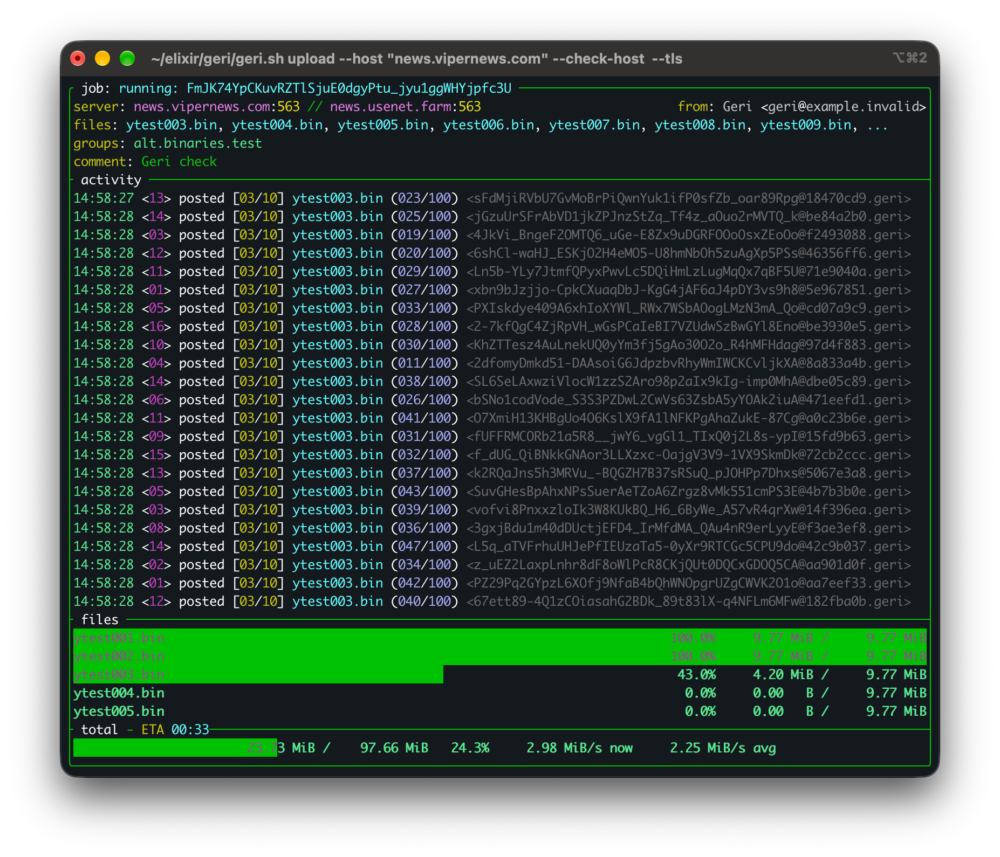
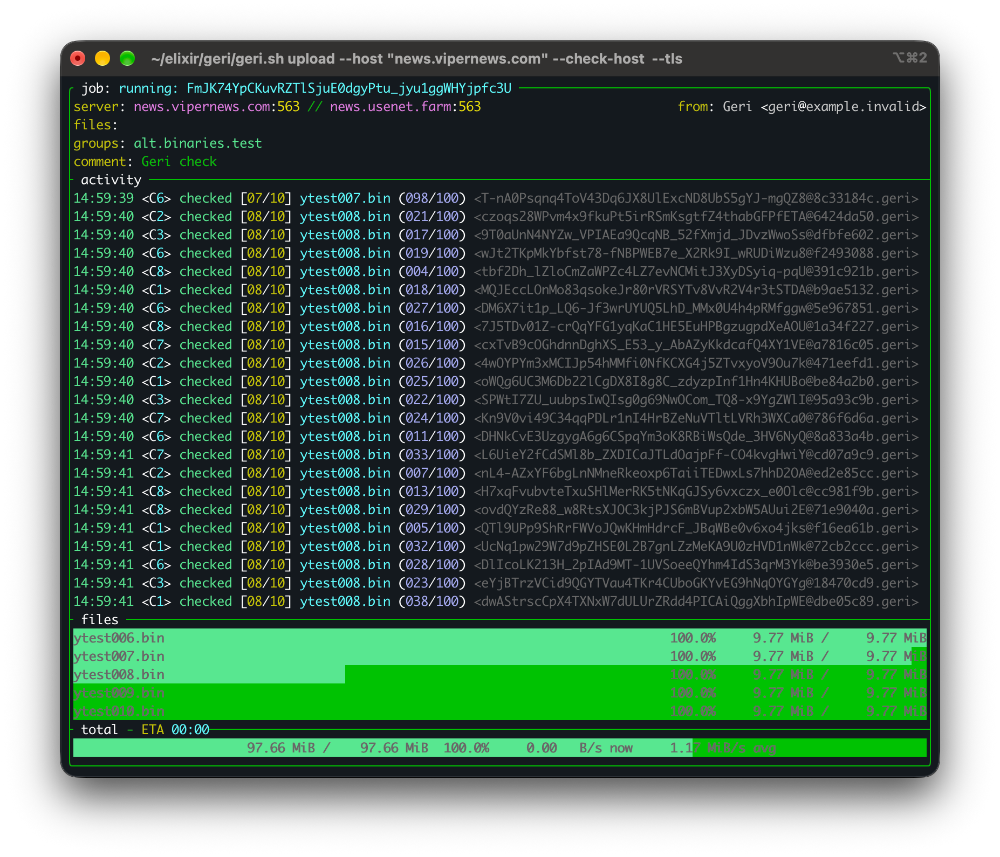

# Geri

Geri uploads binary files to NNTP servers, writes NZBs, and can check article
propagation and repair missing articles. It supports yEnc (the default),
UUEncode, and Base64.

## Screenshots

Posting files:



Checking article propagation:



## Installation

Geri requires Elixir 1.20 and a compatible Erlang/OTP installation. On
macOS (OS X), install Elixir with [Homebrew](https://brew.sh/):

```sh
brew install elixir
```

Homebrew installs Erlang/OTP as a dependency. On other operating systems,
follow the [Elixir installation instructions](https://elixir-lang.org/install/).
Check your installation with `elixir --version`.

Install Git if needed, then download Geri and set up Hex, Mix's package manager:

```sh
brew install git rust
git clone https://github.com/realNeodome/geri.git
cd geri
mix local.hex --force
```

The TUI build also requires Rust/Cargo and a C/C++ compiler (on macOS, the
Xcode Command Line Tools). Geri bundles a small ExRatatui extension so layout
uses the renderer's own Unicode width calculation. Its first native build
can take several minutes; later builds reuse Cargo's cache. Headless builds
do not require Rust.

Fetch the application dependencies, build the release, and install:

```sh
MIX_ENV=prod mix deps.get
MIX_ENV=prod mix release --overwrite
./install.sh
```

The installer defaults to `/usr/local`. If that directory requires elevated
permissions, run only the installation step with `sudo ./install.sh` or from
a root shell. Build as your normal user. The installer copies an already
built release; it does not compile or fetch dependencies.

For a personal installation without root, use:

```sh
./install.sh --prefix "$HOME/.local"
export PATH="$HOME/.local/bin:$PATH"
```

Ensure the installation prefix's `bin` directory is in PATH, then run
`geri --help`. Add the PATH setting to your shell startup file if needed.

See [Building and installation](docs/installation.md) for more details,
upgrades, and removal. If ExRatatui/Ratatui is unavailable on your platform,
or you do not need a terminal UI, follow the guide's headless installation
instructions; that build excludes the terminal UI and its native dependency.

### Updating an existing installation

After updating or changing the source, rebuild the release:

```sh
MIX_ENV=prod mix release --overwrite
```

`mix release` compiles the production application as needed; separate
`mix compile` and `mix escript.build` commands are not required. If you use
an installed copy, rerun the installer with the same prefix after rebuilding
to update it. Follow the [installation guide](docs/installation.md) for
headless builds and other installation options. Stop running jobs before
upgrading an installed release.

## Basic usage

The examples use placeholder server names. Replace them with your servers
and choose a group where posting is allowed. Credentials are read from
`~/.authinfo` or `~/.netrc`; use `--auth-file FILE` to choose another file.
For example, `.authinfo` can contain:

```text
machine news-a.example.com login YOUR_USERNAME_A password YOUR_PASSWORD_A
machine news-b.example.com login YOUR_USERNAME_B password YOUR_PASSWORD_B
```

Add one entry per server and restrict the file permissions with
`chmod 600 ~/.authinfo`.

Without a command-line username, Geri takes both username and password from
the matching entry. With `--username`, `--check-username`, or
`--repair-username`, password lookup is restricted to that username on the
selected server. An exact host-and-port entry takes precedence over a
host-only entry; omitting `port` lets an entry match any port on that host.
Server-specific entries take precedence over `default` entries. Equally
specific matches use the earlier file entry, with `.authinfo` searched
before `.netrc`.

If no entry matches and no credentials were supplied, Geri connects without
authentication.

Posting on A, checking on B, and repairing on C resolve their credentials
independently. ABB repair inherits B's resolved credentials unless repair
endpoint or authentication options override them. Incomplete credentials
are rejected.

Options precede filenames; `--` separates the two. These examples use TLS,
the default yEnc encoding, and no TUI.

Run the installed release with `geri upload ...`, or use `./geri.sh upload ...`
from the source directory after building the release. For interactive
progress and controls, replace `--no-tui` with `--tui` in a build with TUI
support. Run `geri --help` for all options.

`--from` accepts a bare ASCII email address. Supply an optional display name
separately with `--name`, for example `--from uploader@example.com --name 'Géri'`.
Quoted addresses and combined name/address forms are not supported. Geri
encodes Unicode sender names and Subjects as MIME headers and stores the same
encoded values, unfolded and XML-escaped, in the NZB. UTF-8 filenames are
preserved without renaming or normalization; invalid UTF-8, line breaks, and
characters forbidden in XML are rejected before uploading.

### Simple upload

Post files to server A and write an NZB:

```sh
geri upload \
  --host news-a.example.com --tls implicit \
  --from uploader@example.com --name 'Géri' \
  --group alt.binaries.test \
  --part-size 700K --connections 8 \
  --nzb upload.nzb --no-tui -- ./*.bin
```

### ABB: upload to A, check on B, repair on B

Geri checks propagation on server B. Articles still missing after the
checking passes are posted to B. The repair server defaults to the checking
server, so `--repair-host` is unnecessary here. B must permit posting.

```sh
geri upload \
  --host news-a.example.com --tls implicit \
  --check-host news-b.example.com --check-tls implicit \
  --from uploader@example.com --name 'Géri' \
  --group alt.binaries.test \
  --part-size 700K --connections 8 \
  --check-connections 2 --repair-connections 2 \
  --nzb upload-abb.nzb --no-tui -- ./*.bin
```

### ABC: upload to A, check on B, repair on C

Use a separate posting server C for repairs. Checking still takes place
on B; `--repair-host` does not change the checking server.

```sh
geri upload \
  --host news-a.example.com --tls implicit \
  --check-host news-b.example.com --check-tls implicit \
  --repair-host news-c.example.com --repair-tls implicit \
  --from uploader@example.com --name 'Géri' \
  --group alt.binaries.test \
  --part-size 700K --connections 8 \
  --check-connections 2 --repair-connections 2 \
  --nzb upload-abc.nzb --no-tui -- ./*.bin
```

## Upload controls

The `geri` and `./geri.sh` launchers handle Ctrl-C without the Erlang break
menu. The first Ctrl-C requests cancellation;
a second Ctrl-C forces exit. Cancellation returns shell exit status 130.
Active operations can finish before shutdown; stalled connections are
closed after a ten-second grace period. A connection still being established
can take its configured connection timeout to return.

With `--tui`, press `p` to pause or resume. New posting, checking, and repair
operations wait while paused; active operations finish and idle connections
close. Queues, recovery information, and the NZB writer stay in memory.
Press `q` or Escape to hide the TUI; this does not cancel the upload.
Pause does not persist state across process exits.

### IEx inspection

With the TUI active, press backtick (`` ` ``) to pause and open IEx in the same
running VM. The prompt prints the available bindings and how to return.
For example:

```elixir
Geri.JobState.snapshot(job)
:sys.get_state(job)
:sys.get_state(queue)
workers
opts
resume.()
```

`job`, `queue`, `checker`, `workers`, `producer`, and `control` refer to live
processes; `opts` contains the upload options with passwords redacted.
`checker` is nil when checking is disabled. `resume.()` closes the inspection
session, restores the TUI, and resumes work. Use it instead of Ctrl-D:
Ctrl-D can leave the terminal input device at EOF and prevent later IEx
sessions from accepting input. Avoid `System.halt/0`
or terminating the IEx evaluator, since this is the upload's VM.

See the [IEx inspection guide](docs/iex-inspection.md) for examples of
examining progress, verification, queues, worker processes, recovery state
and NZB bookkeeping.

## Retrying an interrupted upload

Geri prints an upload key when the job starts. Save it and add
`--upload-key 'YOUR_SAVED_KEY'` when restarting the same batch with the same
encoding and part size. Geri rebuilds the articles from the current source
files and uses STAT to skip Message-IDs already present on the posting server.

If a source file intentionally changed, wait until it stops changing before
restarting. Articles whose Message-IDs remain unchanged can be skipped;
changed articles receive new IDs and are posted. Changing a yEnc file's size
or total part count can change every article's ID, requiring the whole file
to be posted again. Articles from the earlier version remain on the server.

If an NZB was requested, cancellation or failure preserves the unfinished
NZB as `.part`. A restart creates a new NZB; it does not continue writing the
old `.part` file. Choose a new `--nzb` filename if the previous NZB or its
`.part` file still exists.

NZB output requires a filesystem that supports hard links. Geri creates
`.part` exclusively and publishes the completed NZB without replacing an
existing destination. On normal success, `.part` is removed. If publication
fails, Geri reports a finalization error and retains the completed `.part`.

## Tests

Run the regression tests locally:

```sh
mix test
```

This runs all test files, including the timeout and repair regressions.
Some tests exercise the real 30-second network timeout, so allow roughly
90 seconds for the suite. For a headless build, use `GERI_TUI=false mix test`.

## License

Geri is licensed under the [BSD 2-Clause License](LICENSE).
Third-party dependencies retain their own licenses.
