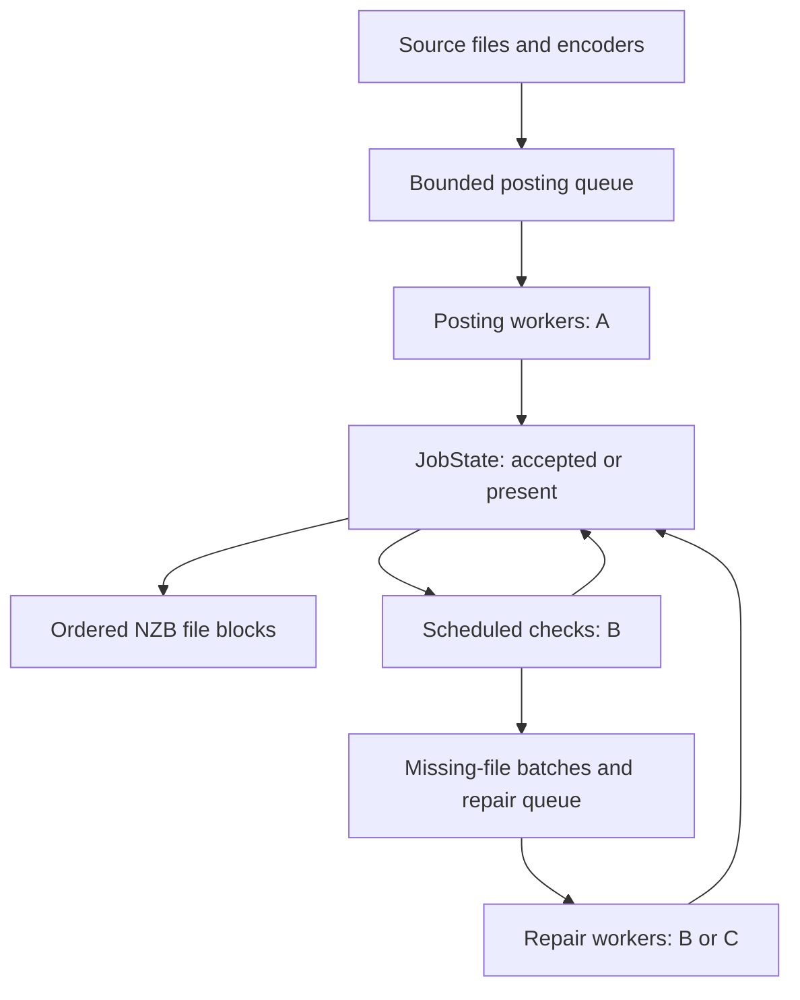
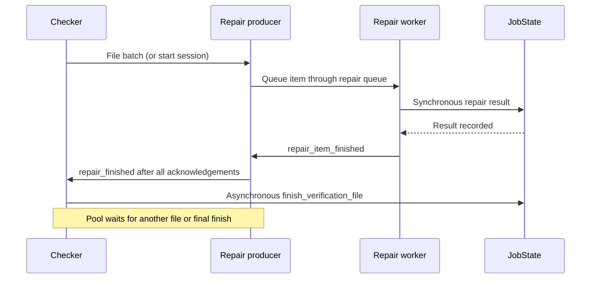

# Geri architecture

This guide explains the current implementation for contributors who need to
change Geri without losing its failure-handling and bookkeeping guarantees.
Start with the [README](../README.md) for usage, the
[installation guide](installation.md) for builds, and the
[IEx inspection guide](iex-inspection.md) for examples of live state.

This is a description of the implementation, not a proposed replacement
architecture. Internal maps and messages are not a versioned external API.
When changing an invariant, update its implementation, regression tests, and
this guide together. Paths and function names below identify useful starting
points; they are not a requirement to preserve today's module boundaries.

## Contents

- [Orientation and vocabulary](#orientation-and-vocabulary)
- [Source map](#source-map)
- [Job startup and ownership](#job-startup-and-ownership)
- [Endpoints and credentials](#endpoints-and-credentials)
- [Parts, articles, and identity](#parts-articles-and-identity)
- [Posting and connection recovery](#posting-and-connection-recovery)
- [State domains and completion](#state-domains-and-completion)
- [Checking and repair](#checking-and-repair)
- [Calls, casts, and ordering](#calls-casts-and-ordering)
- [Pause, cancellation, and cleanup](#pause-cancellation-and-cleanup)
- [NZB writing and publication](#nzb-writing-and-publication)
- [Terminal, Unicode, and inspection](#terminal-unicode-and-inspection)
- [Build, launcher, and installation](#build-launcher-and-installation)
- [Changing the code safely](#changing-the-code-safely)
- [Current limits and deferred work](#current-limits-and-deferred-work)

## Orientation and vocabulary

Geri runs a finite upload in one BEAM VM. A producer streams source files,
encodes their parts, builds articles, and feeds posting workers through a
bounded queue. An optional checker schedules propagation checks and arranges
repairs. One JobState process owns upload bookkeeping. Control coordinates
pause and cancellation across posting, checking, and repair.

| Term | Meaning |
| --- | --- |
| A | Initial posting endpoint |
| B | Propagation-checking endpoint |
| C | Separate repair endpoint, when configured |
| ABB | Post to A, check on B, repair on B |
| ABC | Post to A, check on B, repair on C |
| Part | Encoding metadata and encoded body for one source-file chunk |
| Article | NNTP headers plus encoded body, with its Message-ID |
| Check item | Body-free metadata sufficient to check and reconstruct one article |
| Batch | In checker-driven repair, missing items from one file; not a new posting job |
| Pool | Producer/worker task group; a repair pool can process multiple file batches |
| Upload key | Identity input used to regenerate Message-IDs; not a saved checkpoint |
| Resolved | Informally, no longer needing checking/repair; use explicit outcomes in code |

The following shows data flow, not links or a supervision tree. A and B may
be the same physical service; B and C may share a hostname but use different
listeners. Their roles remain distinct.

Posting and repair use the same queue implementation and much of the same
worker implementation. They use **different queue instances and task groups**.
Checking uses a due-time scheduler rather than that prepared-article queue.

## Source map

All library paths in this table are relative to the repository root.

| Source | Responsibility |
| --- | --- |
| `lib/geri.ex` | Public upload entry point, resource lifetime, production, shared posting/repair task machinery, posting recovery, repair reconstruction, role-option resolution |
| `lib/geri/options.ex` | Common upload-option validation and normalization before job resources are opened |
| `lib/geri/auth.ex` | Auth-file parsing, entry selection, and credential-pair validation |
| `lib/geri/encoder/source.ex` | Streaming reads with initial-size and EOF checks |
| `lib/geri/encoder/{yenc,base64,uuencode}.ex` | Part boundaries, encoding, and encoding-specific metadata |
| `lib/geri/article.ex` | Article headers and deterministic Message-ID generation |
| `lib/geri/header.ex`, `lib/geri/filename.ex` | Header encoding and filename validation, with different text contracts |
| `lib/geri/nntp.ex` | TCP/TLS setup, greetings, reader mode, authentication, NNTP commands, framing and dot transparency |
| `lib/geri/session.ex` | Shared connection setup, Control registration before authentication, and authentication-failure closure; no admission or retry policy |
| `lib/geri/queue.ex` | Blocking bounded FIFO, orderly close, and abort |
| `lib/geri/job_state.ex` | Single owner of progress, recovery, verification accounting, NZB buffering, and inspection snapshots |
| `lib/geri/verification.ex` | Pure verification-accounting transformations; no process or sockets |
| `lib/geri/recovery.ex` | Pure prepared-part/frontier bookkeeping, posting completion, file retirement, and job-completeness predicate; no process or file I/O |
| `lib/geri/checker.ex` | Check workers, scheduling/retries, terminal file checks, and persistent repair-session coordination |
| `lib/geri/control.ex` | Network-operation admission, connection registry, pause/cancel state, and diagnostic context |
| `lib/geri/nzb.ex` | XML serialization, writer I/O, exclusive creation, and publication |
| `lib/geri/cli.ex`, `lib/geri/signals.ex` | CLI parsing/result presentation and signal-to-cancellation integration |
| `lib/geri/terminal.ex`, `lib/geri/inspection.ex` | TUI/IEx lifetime, terminal ownership, and inspection I/O proxy |
| `lib/geri/tui.ex`, `lib/geri/tui/*.ex` | Rendering, input, display-cell measurement, progress bars, and console-logger handoff |
| `mix.exs`, `config/config.exs`, `build_support/version.exs` | Build variants, native dependency configuration, logging defaults, and version derivation |
| `geri.sh`, `install.sh` | Release selection, signal bridge, installation lock and rollback |
| `vendor/ex_ratatui/` | Bundled native TUI dependency, including renderer-compatible width measurement |

## Job startup and ownership

`Geri.upload/2` is synchronous: it returns after the upload's normal completion
or handled failure and cleanup. `Geri.CLI` is an adapter around it; the core
upload path does not need a terminal UI.

The startup sequence is:

1. Normalize options and validate input paths through `Geri.Options`.
2. Resolve A's credentials, B's options/credentials, and repair options/credentials.
3. Determine whether a caller supplied an upload key, then generate one if absent.
4. Start JobState, including the optional NZB writer; start Control and attach it.
5. Create/register the posting queue and start the optional checker.
6. Attach the checker to JobState and start the optional terminal coordinator.
7. Run the posting producer and workers under a temporary task supervisor.
8. After posting succeeds, drain checking and repairs, finalize output, and clean up.

Early validation is deliberate: routine invalid input should fail before
opening an NZB or creating network workers. File validation is not an immutable
snapshot or a guarantee that later reads cannot fail.

The caller executing `Geri.upload/2` owns the nested resource scopes in
`do_upload/2`, `run_job/4`, and `complete_upload/6`. `try/after` blocks release
resources in those scopes. There is no application callback constructing a
permanent upload supervision tree and no automatic job restart.

| Process/resource | Lifetime and ownership |
| --- | --- |
| JobState | Linked to the upload caller after successful initialization; owns the NZB writer and bookkeeping |
| Control | Linked to the upload caller; monitors registered actors and queues |
| Posting queue | Job-scoped GenServer; closed by producer completion, stopped by outer cleanup |
| Posting task supervisor | Temporary scope in `run_batch/6`; owns producer/worker tasks |
| Posting producer/workers | `Task.Supervisor.async_nolink` tasks monitored by the batch owner |
| Checker | Job-scoped GenServer linked to its caller; traps exits from its children |
| Check workers | Linked processes created by Checker; no replacement worker is started after a crash |
| Repair-session owner | Linked to Checker; runs `Geri.repair_session/5` and owns a temporary task scope and separate queue |
| Repair producer/workers | Created lazily with the first repair session; retained between its file batches |
| Terminal | Optional linked coordinator; monitors its unlinked TUI and inspection process |
| Network socket | Opened/used by the corresponding network worker; registered in Control for coordinated closure |

Control is a registry/coordinator, not the socket's owning process in the
transport API. Its monitoring and explicit close operations complement the
worker's own cleanup. Worker count and open connection count are different:
all configured task slots may exist, but a connection is opened only when a
worker actually receives work.

Tasks return ordinary failures or send monitor exits to the batch owner.
`await_batch/4` retains the first failure; shutdown errors must not replace it.
This explicit handling covers the producer/worker paths. It does not promise
that an arbitrary crash of every linked state owner becomes a normal upload
result. Preserve that distinction when extending failure handling.

## Endpoints and credentials

Options are keyword lists. CLI values are parsed into Elixir values before
`Geri.Options.normalize/2` supplies execution defaults. That common boundary
also validates required text, groups, choices, numeric ranges, regular nonempty
files, filename encoding, and encoding-specific effective part sizes.

Checking is enabled by `check_host`. Without it, no Checker is started.
A, B, and repair credentials are resolved before work begins. Resolved repair
settings are passed to Checker through `checker_options/1`; they must not be
reinterpreted there with different inheritance rules.

`repair_endpoint/1` currently distinguishes these cases:

| Configuration | Repair behavior |
| --- | --- |
| No separate repair endpoint | Use B's host, port, transport, reader setting, TLS verification, and CA setting unless explicitly overridden |
| Explicit `repair_host`, even if it repeats B's hostname | Use independent endpoint defaults |
| Explicit repair port different from B's port | Inherit the hostname if omitted, but use independent endpoint defaults |
| Explicit repair TLS mode different from B's mode | Treat transport settings independently; choose its standard port if no repair port is supplied |

Independent defaults are implicit TLS, peer verification, the system CA store,
and no reader-mode request. Explicit repair values take precedence. A supplied
`false` is a value, not an absent option: `--no-repair-reader` must override a
true checking-reader setting. Standard ports are 563 for implicit TLS and 119
for plain TCP or STARTTLS. An explicit port always wins.

ABB normally reuses B's resolved credential pair. An explicit repair username,
password, or auth-file selection triggers repair credential resolution instead.
An independent endpoint does not borrow B's resolved credentials or its
check-specific auth-file selection. It uses its repair auth-file override or
the general auth-file selection. Port participates in auth-file matching.

`Geri.Auth` selects entries matching hostname, effective port, and an explicitly
requested username. Named machine entries outrank `default`; within that rank,
port-specific entries outrank entries without a port. Equal-ranked entries
retain their earlier selection. Without an explicit auth-file path, the search
considers `.authinfo` and `.netrc`. `auth_file: false` disables file lookup.
The parser implements a subset of authinfo/netrc syntax, not a general netrc
interpreter; inspect `auth.ex` and its tests before extending that subset.

Credentials may exist in raw process state. Public JobState snapshots omit
them, and the options stored in Control's inspection context redact passwords.
Do not turn a raw-state dump into an ordinary log or add AUTHINFO values to
command logging.

## Parts, articles, and identity

### Production pipeline

`produce/4` visits input paths in order. `produce_file/6` obtains a lazy encoder
stream, assigns batch position and source offset, and constructs the subject.
For each prepared part it then:

1. Waits at the Control admission point.
2. Builds a `%Geri.Article{}`.
3. Synchronously records the prepared part in JobState recovery/UI state.
4. Pushes `{part, article}` into the posting queue.

Recording preparation before queue admission ensures that blocked or failed
queue insertion does not make prepared work invisible to failure diagnostics.
Encoding a chunk can already have happened before the Control wait; pause is
not a guarantee that all file reading and CPU work stop immediately.

The queue's capacity is `connections * 2` articles. Push blocks when ready
capacity is full; next blocks while the queue is open and empty. A waiting
consumer can receive an item directly. `close/1` rejects new pushes and lets
ready items drain to `:done`. `abort/2` discards ready work and wakes blocked
producers/consumers with an error. Close is used after a producer has finished
its pushes; it is not an alternative to aborting an outstanding producer.

### Units and representations

| Field/representation | Contract |
| --- | --- |
| `file_number`, `part` | One-based ordinals |
| `total` | Part count in an encoder/prepared part |
| `part_total` | The same count in a check/repair item |
| `file_size`, `source_size` | Original source bytes, not encoded bytes |
| `offset` | Zero-based byte offset for repair `pread` |
| yEnc `begin`, `end` | One-based inclusive source positions |
| `source_hash` | Raw SHA-256 binary of this part's original source bytes |
| yEnc `pcrc32` | CRC32 of this part's source bytes |
| yEnc `crc32` | Running CRC32 through this part; final part contains the whole-file CRC |
| `part.body` | Encoded body, including encoding-specific control lines |
| `article.data` | Complete CRLF-framed article, before NNTP dot stuffing and final terminator |
| `article.from`, `article.subject` | Header-encoded values unfolded for NZB attributes |
| NZB segment `bytes` | Current implementation: `byte_size(article.data)`, not source bytes or dot-stuffed wire bytes |

For Base64, effective part size is rounded down to a multiple of 57 source
bytes; UUEncode uses a multiple of 45. yEnc uses the requested source-byte part
size. These choices determine offsets and part totals and must agree between
initial encoding and repair reconstruction.

A check item retains path, filename, encoding, source offset/size/hash,
file/part ordinals and totals, subject, Message-ID, and yEnc reconstruction
metadata. It deliberately omits the encoded body and full article. Repair queue
entries are `{item, rebuilt_part, rebuilt_article}` rather than posting's pair.
See the IEx guide for abbreviated maps and queue examples.

### Source consistency

`Geri.Encoder.Source.stream_file/3` checks each chunk against the initially
observed size, checks total observed bytes at EOF, and stats the path again.
Truncation or growth produces a source-size failure rather than a successful
short upload. Exhausting the producer stream matters: final size checks happen
when the stream reaches its end.

This does not lock the input, take a filesystem snapshot, or detect every
same-size edit during initial posting. Inputs are expected to remain stable.
Repair has an additional check: it reads exactly the recorded slice and verifies
its SHA-256 hash before rebuilding an article. A different file or changed
slice must fail rather than silently repair with unrelated bytes.

### Message-ID contract

The upload key is the HMAC-SHA256 key. The current `GERI2` identity payload
contains an encoding identifier, length-prefixed filename bytes, part number,
total parts, and SHA-256 of the encoded body. The digest is URL-safe Base64
without padding. The domain is the running CRC32 plus `.geri` for yEnc, or
`message_id_domain` (default `geri.invalid`) for the other encodings.

Thus the source hash and identity hash serve different purposes. Hashing only
source bytes would lose reconstruction metadata embedded in the encoded body.
A stable key alone does not guarantee a stable ID if encoding, boundaries,
filename, metadata, or the yEnc CRC-derived domain changes.

Batch position, source directory, From, Subject, groups, and Date are not part
of the generated identity payload. Reordering the batch can therefore retain
IDs even though displayed subjects change. Rebuilding a repair can also use a
new Date while retaining the same ID. Do not describe IDs as a hash of the
entire wire article. A caller-supplied `message_id` bypasses generation.

Changes to encoding output or identity serialization can change existing IDs.
Treat them as compatibility decisions, not incidental formatting changes.
`article_identity_test.exs` protects these distinctions.

### Text contracts

Filename validation preserves bytes: valid UTF-8 is required and protocol line
breaks/XML-forbidden characters are rejected. There is no normalization or
silent renaming. Display truncation must never change the filename used for
encoding, identity, repair paths, or NZB content.

Headers have a separate contract. From is a bare ASCII address plus an optional
separate display name. `Geri.Header` quotes ASCII names and MIME-encodes text
when needed, keeping UTF-8 codepoints intact within encoded words. NNTP headers
and NZB attributes derive from the same header representation; NZB serialization
then applies XML escaping. MIME encoding and XML escaping are different steps.

## Posting and connection recovery

`Geri.NNTP` handles protocol operations; `Geri` decides what an operation's
outcome means for an upload. TCP and TLS sockets are passive line-mode sockets.
Connection setup includes the greeting and optional MODE READER; authentication
follows through `Geri.Session.connect/1` in the worker. STARTTLS reads the initial
greeting on raw TCP, upgrades, and then performs reader-mode setup. Do not
casually reorder these stages.

Status responses are bounded to 512 bytes, require CRLF, and are parsed before
being returned to the caller. `recv_response/1` closes a connection after an
incomplete or malformed receive. A late reply must not be consumed as the
answer to a later command on that connection.

A network operation follows Control checkout, lazy connection establishment,
registration, authentication as needed, operation, and checkin. Checkout returns
the registry's connection for an existing actor, which may be `nil` after a
pause. The worker's cached variable is not authoritative.

`Geri.Session.connect/1` owns the shared setup/registration/authentication
sequence and returns the original error shapes. It requires caller checkout
when Control is present and does not check in or retry on the caller's behalf.
Authentication failure closes the socket; failed registration after cancellation
is closed by Control. Transport/greeting/TLS failures remain NNTP's responsibility.

Posting retains an additional registration check after setup/authentication,
both initially and during reconnect recovery. These are cancellation checks:
authentication may succeed after cancellation was requested. Reused posting
connections also pass the outer check before STAT/POST. The checker retains its
existing operation boundary and checks cancellation after its operation/checkin;
sharing setup does not merge those policies. Do not remove registration merely
because the same socket was registered before AUTHINFO.

| Posting observation | Current action |
| --- | --- |
| Preliminary STAT says present | Complete the posting item without POST |
| Preliminary STAT says missing | POST on that connection |
| Preliminary STAT returns a complete unexpected status | Log the inability to check, then attempt POST |
| Preliminary STAT loses framing/transport | Discard the socket, reconnect, and repeat verification on a fresh connection |
| POST fails before article transmission | Reconnect and retry POST |
| Article send or final response fails | Outcome is uncertain: reconnect and STAT before deciding whether to repost |
| POST is rejected | STAT the ID; presence converts the result to success, otherwise preserve the posting rejection |
| Recovery STAT says present | Complete successfully without reposting |
| Recovery STAT says missing or returns a complete unexpected status | Attempt POST |
| Recovery STAT loses framing/transport | Discard the connection and repeat recovery on a fresh one |

`:before_article` and `:uncertain` transport tags are part of the recovery
contract. `nil` in a worker result means there is no reusable connection.
Logical server rejection and an unsynchronized response stream are different;
a catch-all retry on the old socket would erase that distinction.

Supplying an upload key enables preliminary STAT for every initial posting
item. Misses do not disable later preliminary STATs. Repair skips that initial
preflight, but shares rejection checking and uncertain-POST recovery.

Initial connection failure ends that posting operation. After a transport
failure enters reconnect recovery, failed reconnections repeat with a fixed
configured delay and no overall retry budget. `Control.wait/2` makes that delay
interruptible. This asymmetry is current behavior, not a recommended permanent
error classification.

Current transport constants are 15 seconds for connection/TLS setup calls and
30 seconds for response receives. There is no explicit configured send timeout
or end-to-end transfer deadline. A successful send call does not establish
server acceptance; only a response or a later presence check can do that.
`quit/1` sends QUIT and closes without receiving a reply, but the send itself is
not a general nonblocking-shutdown guarantee.

## State domains and completion

JobState is one GenServer so updates to its owned data are serialized. Its
state domains are intentionally different representations of the same job.

| Domain | Contents | Retirement/completion condition |
| --- | --- | --- |
| `job` and `posting` | Configuration, ordered input paths, aggregate sizes, endpoint/display data, posting credentials | Job lifetime |
| `recovery` | Per-file producer frontier and unresolved prepared parts | All planned parts prepared and none unresolved; replace file details with completed-file count |
| `verification` | Per-file outcome sets, unresolved check/repair metadata, historical counters | Fold a file only after its checks and any repair batch finish |
| `nzb` | Writer and per-file successful segment metadata | Emit complete files in input order; then discard their segment maps |
| `ui` | Aggregate progress, small file window, bounded activity | Trim by display policy, independently of actual work completion |

### Recovery frontier

JobState owns the recovery map and delegates its transformations to
`Geri.Recovery`: `new/0`, `prepare_part/4`, `complete_part/2`,
`retire_completed/1`, and `complete?/2`. The module receives only recovery state,
part/article metadata, and a caller-supplied path; it does not inspect the rest
of JobState or read files. This is a code boundary, not a new process or saved
state format.

`JobState.prepare_part/3` records `message_id` and `source_hash` under the part number
and advances `next_part`. Here `next_part` is the next part after the highest
prepared part, not the lowest unposted part. Unresolved entries below it capture
holes created by parallel workers. Preparation is sequential; completions can
arrive in another order.

`JobState.complete_part/5` removes a successfully handled posting part from recovery.
A file is complete when its frontier is beyond `total_parts` and its unresolved
map is empty. Completed file records are purged and counted. Job finalization
requires every input file to have completed, even when no NZB was requested.
UI disappearance or an empty queue is not sufficient evidence.

Completion and retirement remain separate. JobState removes the completed part,
updates progress/output metadata, and attempts the NZB flush before retiring
finished recovery files. A write failure therefore retains the existing
failure-reporting shape, including file records whose unresolved map is already
empty. `completed_files` counts retired files; it is not the highest completed
file number or a contiguous prefix like verification's finished-file frontier.

Recovery state is in memory. It is not currently serialized, and a restart does
not load it. It is also separate from verification's `unresolved` map: an article
can be posted successfully and still be awaiting a propagation check.

### Verification accounting

`Geri.Verification` is a pure state transformation module called by JobState.
While a file is active, its outcome sets prevent repeated events of the same
kind from increasing counters twice. Finished files reject late results.

| Outcome | Meaning |
| --- | --- |
| Pending metadata | Posted item admitted for checking; retained until resolved or retained as a failure |
| `confirmed` | Found on B by checking |
| `missing` | Checking exhausted its missing-result passes on B |
| `repaired` | Accepted or found present on the repair endpoint |
| `repair_failed` | A repair article's posting operation failed |
| `inconclusive` | Checking could not establish presence/absence within its error policy, or checking workers stopped |

These outcomes are not simply mutually exclusive buckets. An item may first
be missing and later repaired. Reported missing count subtracts repaired parts;
repair success does not increment confirmed count. An unrepaired missing item
can also have a repair-failed outcome. Temporary `:not_found` activity is not a
terminal missing result.

`finish_file/2` folds per-part sets into upload-wide counters and drops successful
details. It retains unresolved metadata. A contiguous finished-file frontier
plus a set of out-of-order finished file numbers prevents late results from
recreating discarded state without retaining a key for every successful article.

JobState result precedence is: explicit checking/repair errors or remaining
missing/repair-failed parts produce verification failure; otherwise inconclusive
parts produce an inconclusive result; otherwise verification succeeds.

### UI state is a projection

The active file number moves forward and does not move backward for a slow
worker's late completion. JobState retains a window of up to seven file rows
(three history, current, three lookahead, shifted near boundaries); the TUI
renders up to five file widgets. Activity retains 64 events. Filename previews
are limited to 32 names. These are display bounds, not work-retention rules.

Global posted and checked bytes count source bytes. Checked progress includes
accepted repairs, so a full checked bar in ABC is not proof that B has all
articles. Speed/ETA currently describe posting progress; elapsed job time
includes pauses and the display is not a verification-completion estimate.

## Checking and repair

### Scheduled checks

Checker has its own idle worker set, PID-to-item inflight map, and
`:gb_trees` scheduler keyed by `{due_monotonic_ms, sequence}`. Sequence makes
same-time entries distinct. A timer wakes dispatch for the next due item when
a worker is available. Each worker handles one item at a time and opens its
connection only for actual work.

The initial check is scheduled 30 seconds after enqueue. Missing results retry
after another 60 seconds, then another 90 seconds: nominally 30, 90, and 180
seconds after enqueue, before network delays, contention, or pauses. These are
relative delays, not three absolute deadlines. Operation errors retry after ten
seconds; three errors end that item's current checking path as inconclusive.
A missing retry advances the propagation attempt and resets its error count.

Checker tracks terminal parts per file separately from JobState's accounting.
This answers a scheduling question: when has every part reached a terminal check
outcome, so we can assemble the missing-file batch or finish the file? JobState's
sets answer result/deduplication questions and remain active through repair.
Combining the two would mix different ownership and lifetime requirements.

### Persistent repair session

Only terminally missing articles enter repair. An operation error is not proof
of absence and must not cause a speculative repair. A file's repair batch waits
until all its parts have terminal check outcomes. Files can finish checking out
of order; repair batches follow their completion/enqueue order, not necessarily
input order. One batch runs at a time, while posting/checking can continue.

The first batch creates a repair-session owner, a separate bounded queue, and
producer/worker tasks. Subsequent batches reuse that live pool and its available
connections. An empty repair queue does not mean future repair work is impossible;
workers can wait for more batches. No missing articles means no repair pool.

`produce_repairs/3` groups items by path and sorts each file's items by offset.
`produce_repair_file/3` opens a raw binary file, uses positioned reads, requires
the exact source size, verifies the recorded hash, rebuilds encoding metadata,
and checks that `Article.build/2` generates the original Message-ID before
queueing. yEnc running CRC metadata comes from the original item; repairing a
later part does not require re-reading all earlier parts to recalculate it.

The completion handshake is deliberately stronger than draining the queue:

An item no longer in the queue may still be in flight. The producer waits for
one acknowledgement per batch item, including recorded per-article repair
failures. Only then may Checker fold that file's accounting. This prevents a
late repair result from being rejected as belonging to an already finished file.

Checker's current fields encode several states: `repair_pid` identifies the
session owner, `repair_producer` becomes available between batches, `repair_file`
identifies the active file, and `repairing` gates the next batch. `repairing: true`
also represents the final wait for pool shutdown. It does not always mean an
article is actively being repaired.

`Checker.finish/1` stops accepting new check items and waits for scheduled
checks, inflight items, file bookkeeping, pending repair batches, and the active
batch. When no future work can arrive, it sends `:finish` to the repair producer.
The producer returns, closes the queue, workers drain/close, and the session
reports `:repair_pool_finished`. Finish waits for that report before returning
the verification result. The checker and its check workers are stopped by the
outer job cleanup; finish does not itself terminate Checker.

Repair success is acceptance or confirmed presence on B/C. In ABC there is no
additional check on B after posting to C. Do not relabel repaired counters as
confirmed propagation.

### Failure scopes

A per-article repair rejection is recorded and the pool can process later items
and batches. A fatal repair preparation/task failure stops that pool, records
an error, and allows Checker to start another pool for a later batch. It must
not cancel the initial posting job through the shared Control process.

A check-worker crash stops checking workers, retains the original crash once,
and marks queued/inflight/future checks inconclusive. Initial posting continues.
Already established missing items can still be repaired, including an active
batch. Late worker messages cannot restore stopped checking or overwrite those
outcomes. An unexpected repair-session-owner exit is also converted into a
recorded repair failure.

## Calls, casts, and ordering

The synchronous/asynchronous boundaries are part of correctness. They are not
interchangeable implementation details.

| Direction | Operation | Reason |
| --- | --- | --- |
| Producer -> JobState | `prepare_part/3`, call | Preparation becomes visible before queue push |
| Posting worker -> JobState | `complete_part/5`, call | Completion bookkeeping and check admission must finish before worker success |
| JobState -> Checker | `enqueue/2`, call | Know whether the checker accepted the item |
| Checker -> JobState | Check results and `finish_verification_file/2`, casts | Avoid a synchronous call cycle while JobState may be waiting on enqueue |
| Repair worker -> JobState | Repair result, call | Establish that the result is recorded before acknowledging the batch item |
| Control -> JobState | Activity, cast | JobState can synchronously query Control; activity must not call back synchronously |
| Checker -> JobState | Final `result/2`, call | Summarize after drain and preceding completion notifications |

A quick result can reach JobState's mailbox before its enqueue call returns.
That is safe: JobState finishes the current callback, records pending state,
and only then handles the result. Checker-to-JobState messages from that same
sender preserve the order of check-result casts followed by file-finish casts.
Repair results originate in other processes, so they need the explicit
acknowledgement chain described above. Do not rely on ordering between unrelated
senders.

Worker and checker return tuples are also distinct contracts. Posting operations
carry a connection in `{:ok, conn}` or `{:error, reason, conn}`. NNTP STAT returns
`:present`, `:missing`, or an error. Preserve the connection and uncertainty
information when consolidating helpers; flattening everything into one generic
success/error wrapper would lose useful semantics.

## Pause, cancellation, and cleanup

Control's states are `:running`, `:pausing`, `:paused`, and `:cancelled`.

| Event | Transition/action |
| --- | --- |
| Pause while running | Emit request activity, enter pausing, close idle connections, block new admission |
| Last busy network actor checks in/exits | Close its connection as appropriate, enter paused, emit completion activity |
| Resume while pausing or paused | Enter running and reply to waiting admissions; later work reconnects lazily |
| Cancel | Enter cancelled, abort registered queues, wake actors/admissions, and start grace timer |
| Cancel again through CLI/TUI signal handling | Force process exit with status 130 |

Repeated pause/resume requests are idempotent in their settled states. A resume
while pausing cancels that pause transition; a later checkin must not emit a
stale paused event. Cancellation cannot be undone by resume.

An actor is registered/marked busy at checkout; checkin marks it idle. Admission
waiters are not doing new network operations. `await_idle/1` concerns registered
network activity, not every process, timer, encoder, queue, or file operation.
The producer can prepare a chunk before its admission wait; scheduled checks
and bookkeeping messages can still advance while the network is paused.

Cancellation aborts both prepared-article queues registered with Control and
interrupts retry waits. Active registered connections get ten seconds to finish,
then Control closes them to interrupt receives. A connection still inside
`NNTP.connect/1` has not yet reached worker registration; setup/greeting/TLS
waits can therefore outlive that grace period until their own timeout returns.
This is cooperative cancellation with a closure fallback, not a hard deadline
for terminating all code.

Control's cancelled state is also used to stop peers after a fatal posting error.
It does not by itself prove that the user requested cancellation. The batch
owner's retained result determines whether the final outcome is upload failure
or user cancellation. Fatal repair failure uses a different shutdown scope so it
does not convert a repair error into cancellation of unrelated posting.

After initial posting succeeds, the orchestrator finishes verification, waits
for idle network actors, and finalizes the NZB even if checking/repair failed.
Cancellation skips that success-finalization path. Cleanup then stops Terminal,
Checker, the posting queue, JobState, and Control through their nested scopes.
JobState abort closes only a still-present writer; a successful finalization has
already cleared it. Some cleanup paths tolerate already-stopped processes so a
secondary failure does not hide the first task error.

Core results include `{:ok, upload_key}`, cancellation with diagnostic details,
upload/finalization failure with a reason and details, verification failure with
an error list, and verification inconclusive. Early validation/authentication
can return errors before a JobState exists and therefore without job details.

| CLI outcome | Exit status |
| --- | --- |
| Success | 0 |
| Invalid invocation, posting/finalization failure, verification failure, or repair failure | 1 |
| Verification inconclusive without a higher-priority failure | 2 |
| Cancellation | 130 |

Keep machine-readable core errors separate from CLI strings. See
`failure_reporting_test.exs` for subprocess exit-status checks.

## NZB writing and publication

JobState owns the writer and calls `Geri.NZB`; workers never write XML directly.
Successful posting (including a presence-based skip) records a segment. It also
unions the groups actually passed for that file's completed posting parts.
The file's poster is the encoded/unfolded From; its subject is taken from part
one, even when another part completes first. Segment Message-IDs omit brackets.

A file is ready to emit only after all its segments and its part-one subject
exist. `flush_nzb/1` emits consecutive complete files beginning at `next_file`,
sorts segments by number, and drops emitted metadata. Later complete files wait
if an earlier file is unfinished. Completion order must not scramble NZB order.

Publication is:

1. Create `path <> ".part"` exclusively; refuse occupied output paths.
2. Write the XML header and complete file blocks incrementally.
3. Require posting completeness independently of NZB completeness.
4. Write the closing element and close the writer.
5. Hard-link the temporary file to the final path; this fails if occupied.
6. Remove the temporary name after successful publication.

The hard link closes the overwrite race that an existence check plus ordinary
Unix rename would leave. No destructive fallback is used on filesystems without
hard-link support. A publication failure preserves the completed temporary
output; if unlinking the temporary name fails after linking, both names can
exist and finalization still reports failure.

An interrupted upload normally leaves an unfinished XML document, with complete
file blocks already written and remaining file metadata only in memory. A
`.part` file is not a durable checkpoint and is not reopened for append on retry.
A restart needs a new output path if the final name or temporary name exists.
Successful publication does not claim power-loss durability: the writer does
not perform an explicit filesystem sync as a transaction boundary.

Some write failures currently raise from the writer; JobState's
`nzb_operation/1` translates recognized I/O exceptions into job errors. This is
an existing error boundary to preserve or deliberately replace, not an invitation
to rescue arbitrary programming exceptions. A complete NZB must survive a later
verification failure because its articles were successfully posted to A.

## Terminal, Unicode, and inspection

The TUI reads snapshots; rendering does not own recovery or verification state.
It refreshes every 250 ms. Raw internal maps are richer than the public snapshot,
and separate reads are not an atomic snapshot of all processes.

`Geri.TUI.Text` segments graphemes in Elixir and obtains their display-cell widths
from bundled `ExRatatui.Native.text_widths/1`, using the renderer's width rules.
Truncation takes whole graphemes within a cell budget. Progress-bar styling must
also preserve wide glyphs when a color boundary falls inside their cell span.
Do not replace display width with byte length, codepoint count, or grapheme count.
Keep the native extension when updating the bundled dependency; upstream
precompiled binaries do not contain this added entry point.

Terminal coordinates TUI and IEx transitions and restores console logging when
the TUI closes. While the TUI is active, console logging is suspended and a file
handler appends to relative `log/geri.log`. Preserve the original console-handler
configuration across repeated inspection sessions.

`p` requests pause/resume. Backtick asks Terminal to pause, close the TUI, and
start inspection after network actors are idle. Inspection runs in the upload's
VM with live process bindings and an I/O proxy. `resume.()` makes the proxy
return EOF to IEx's next input request without putting the real terminal input
at EOF. Terminal reopens the TUI and resumes. An unexpected inspection failure
reopens the UI with the upload still paused when reopening succeeds.

`q`, `Q`, or Escape hides the TUI and resumes a paused/pausing upload. It does
not cancel the job. Unexpected TUI exit restores console logging; it is a
different path from an intentional hide. Headless operation has no equivalent
single-key input loop.

IEx is not an isolated sandbox. Raw state can contain credentials, and changes
to the VM-wide working directory affect later source reads, repairs, output,
and relative log paths. Keep the directory unchanged during the upload.
See the inspection guide for diagnostic operations and their effects.

## Build, launcher, and installation

`GERI_TUI=false` selects a build without the native TUI dependency and uses
`_build/headless`; the normal build uses `_build`. Conditional modules are
compiled accordingly. Runtime `--no-tui` uses the same upload engine in a TUI
release; installing a second headless release is unnecessary for that purpose.
Native source builds reuse Cargo output until relevant inputs change.

`geri.sh` resolves its own symlinks and selects an adjacent installed release,
then a source-tree TUI release, then a source-tree headless release. It starts
the application dependencies and calls `Geri.CLI.main/1` through release eval.
The shell preserves stdin, disables BEAM's SIGINT break menu, and bridges shell
INT/TERM to TERM for the release. `Geri.Signals` maps that to Control cancellation;
raw-mode Ctrl-C is handled by TUI input. The shell waits through interrupted
waits and returns the release's status. Starting the raw release by another
route does not automatically supply all wrapper behavior.

`install.sh` copies an already-built release, launcher, README, license, and
docs. It does not fetch dependencies or compile. A private directory under the
prefix serves as lock, staging area, and rollback storage. Installation success
includes the public command link. Failed rollback retains recovery files and
the lock rather than discarding the previous release. Upgrades require existing
jobs to be stopped; this is not hot replacement of a running VM.

`build_support/version.exs` derives the application version from Git tags,
commit distance/hash, and tracked dirty state. Mix refreshes application metadata
even when no source recompilation is needed. Source ZIPs can carry an ignored
`SOURCE_VERSION` fallback because they lack Git history; a valid Git checkout
takes precedence. That stamp is generated packaging metadata, not another
version source to maintain by hand.

## Changing the code safely

Start with the behavior being changed and the owner of that state. Prefer pure
bookkeeping helpers where a new process would not establish a useful ownership
or concurrency boundary. Preserve separate posting and repair resources while
sharing their implementation. Avoid introducing a generic framework merely to
move existing branches elsewhere.

The following test map is a navigation aid, not a claim that each row is
exhaustively tested or that these are the only relevant tests. Paths are under
`test/`; filenames identify suites to read before altering the corresponding
contract.

| Area | Regression suites |
| --- | --- |
| Identity and reconstruction | `article_identity_test.exs`, `source_integrity_test.exs`, `yenc_wrapping_test.exs`, `unicode_headers_test.exs` |
| Common validation and role resolution | `options_test.exs`, `auth_test.exs`, `auth_roles_test.exs`, `server_display_test.exs` |
| Shared setup and registration/authentication lifetime | `session_test.exs`, `auth_roles_test.exs`, `control_test.exs` |
| Response grammar and uncertain posting | `nntp_response_test.exs`, `stat_recovery_test.exs`, `upload_duplicates_test.exs` |
| Task failure and scoped shutdown | `task_failure_test.exs`, `upload_shutdown_test.exs`, `repair_shutdown_test.exs`, `checker_failure_test.exs` |
| Repair-session reuse and completion | `repair_pool_test.exs`, `verification_test.exs`, `failure_reporting_test.exs` |
| Output publication and ordering | `nzb_publication_test.exs`, `failure_reporting_test.exs` |
| Pause and terminal behavior | `control_test.exs`, `pause_activity_test.exs`, `pause_tui_test.exs`, `tui_input_test.exs`, `inspection_test.exs` |
| Display projection and native widths | `ui_window_test.exs`, `tui_unicode_test.exs` |
| Build/install/version contracts | `version_test.exs`, `release_selection_test.exs`, `installation_test.exs` |

Run `mix test` for a TUI-enabled build or `GERI_TUI=false mix test` for headless.
Some tests deliberately exercise the real 30-second receive timeout. Some
checker tests advance the scheduler's due times while keeping real socket
exchanges, avoiding the production propagation delays. Read those intentional
internal-state probes as tests of lifecycle invariants, not public APIs to expose.
A passing headless suite does not validate native rendering or real terminal
handoff; include the TUI suites/manual terminal checks when changing those paths.

When reviewing a lifecycle change, answer these questions:

- Can new work still arrive, or is empty now equivalent to finished?
- Is a missing queue item still in flight somewhere?
- Does an acknowledgement mean queued, sent, accepted, or recorded in JobState?
- Can a synchronous call create a cycle through another state owner?
- Which sender establishes message order, and are other senders involved?
- Can pause invalidate a cached connection before its next use?
- Does a failed operation leave the NNTP response stream reusable?
- Does cleanup preserve the original error and complete output already produced?
- Does retiring UI/history data also remove information needed for repair or output?
- Does a change alter bytes used for identity or reconstruction?

## Current limits and deferred work

These boundaries prevent future work from being mistaken for current guarantees:

- Restart with an upload key regenerates articles and checks A by STAT. It does
  not restore JobState, consume the old NZB, or resume an old `.part` writer.
- Durable recovery/checkpoint loading, standalone NZB checking/refresh/reupload,
  and IHAVE support remain future work; current posting uses POST.
- The prepared queues bound ready article count, not bytes or the whole job.
  Worker-held articles, producer-held work, full input paths, checker backlog,
  active-file outcome sets, unresolved failures, and out-of-order NZB buffers
  have separate memory costs. Retiring successful verification history does
  not impose backpressure on pending verification.
- A slow/stalled earlier part can keep later complete NZB file blocks buffered.
  A large file's missing articles also wait for all its checks before repair.
- Retry classification/budgets, send deadlines, and preliminary-STAT policy are
  explicit future behavior decisions; a structural refactor should not quietly
  change them.
- Source-size checking is not immutable-input enforcement. Repair hashes protect
  recorded slices, not all possible initial-posting mutations.
- Terminal, logger, signal-handler, and working-directory facilities include
  VM-global effects. The one-shot CLI lifetime should not be mistaken for an
  independently isolated service supporting arbitrary concurrent UI jobs.

This guide should evolve with the code. Keep rationale close to the relevant
function when it explains a local trap; use this document for relationships
that span modules and process lifetimes.
